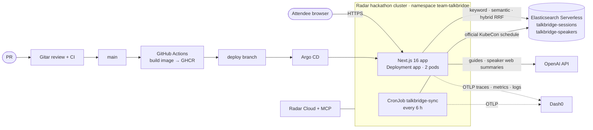

# TalkBridge

**Find the right conference talk and arrive prepared, in your language and at your level.**

Built at the [WeMakeDevs Cloud Native Hackathon](https://www.wemakedevs.org/hackathons/cnh), Salt Lake City, November 9, 2026, by **Hemanth** and **Rahul**.

**Live app:** https://talkbridge.cnh.radarhq.io (runs on our team's Radar hackathon cluster)

---

## The problem

A big conference like KubeCon has hundreds of sessions. Attendees, especially first-timers and people who don't speak English as a first language, struggle to:

1. **find** the few talks that match their background and goals, and
2. **follow** a talk on a topic they're new to.

## What TalkBridge does

| Step           | What the attendee does                                                                                                                                | What happens                                                                                                                                                                                                                                |
| -------------- | ----------------------------------------------------------------------------------------------------------------------------------------------------- | ------------------------------------------------------------------------------------------------------------------------------------------------------------------------------------------------------------------------------------------- |
| 1. About you   | Describes their background and, optionally, a goal ("frontend dev, want to learn Kubernetes monitoring")                                              | **Recommendations**: a semantic search over the real schedule returns the talks that fit them best                                                                                                                                          |
| 2. Search      | Types a query, chooses **keyword / semantic / hybrid**, filters by track, level and day                                                               | Elasticsearch ranks real KubeCon NA 2026 sessions. Hybrid fuses keyword (BM25) and semantic results with **RRF**                                                                                                                            |
| 3. Pick a talk | Selects a session                                                                                                                                     | Shows the official abstract, a link to the official session page, and **speaker cards** (published bio, company, links) with a short AI web summary of the speaker's public professional background                                         |
| 4. Prepare     | Chooses a **language** (English, Español, Português, Français, Deutsch, हिन्दी, 日本語, 简体中文) and a **reading level** (plain / standard / expert) | OpenAI writes a **grounded preparation guide**: key concepts to know beforehand, what the talk covers, and questions to ask. The official abstract is the only evidence about the talk, and general background knowledge is labeled as such |

The whole interface works **keyboard-only and with a screen reader**: visible labels and focus, focus moves to new results and to the guide, `aria-live` status updates, and a correct `lang` attribute on the generated guide.

---

## Architecture



| Layer           | Technology                                                                                    | Where                                                                                                                            |
| --------------- | --------------------------------------------------------------------------------------------- | -------------------------------------------------------------------------------------------------------------------------------- |
| Web app and API | Next.js 16 (App Router), React 19, Tailwind                                                   | [`src/app`](src/app)                                                                                                             |
| Search          | Elasticsearch Serverless, `semantic_text` (embeddings at ingest), BM25, RRF retriever         | [`src/app/api/search/route.ts`](src/app/api/search/route.ts)                                                                     |
| AI              | OpenAI Responses API (guides; `web_search` tool for speaker summaries), 60 s timeout, 1 retry | [`src/app/api/prepare`](src/app/api/prepare/route.ts), [`src/app/api/speakers/insights`](src/app/api/speakers/insights/route.ts) |
| Data refresh    | Kubernetes CronJob syncs sessions and speakers from the official schedule                     | [`k8s/sync-cronjob.yaml`](k8s/sync-cronjob.yaml), [`scripts/sync-sessions.mjs`](scripts/sync-sessions.mjs)                       |
| Observability   | OpenTelemetry Node SDK → Dash0 (traces, metrics, logs)                                        | [`src/instrumentation.node.ts`](src/instrumentation.node.ts), [`src/lib/telemetry.ts`](src/lib/telemetry.ts)                     |
| Delivery        | Docker (multi-stage, non-root), GHCR, Kustomize, Argo CD GitOps                               | [`Dockerfile`](Dockerfile), [`k8s/`](k8s), [`argocd/`](argocd), [`.github/workflows/deploy.yml`](.github/workflows/deploy.yml)   |
| Quality gates   | Gitar review, ESLint, TypeScript, build, gitleaks secret scan                                 | [`.gitar/review/talkbridge.md`](.gitar/review/talkbridge.md), [`.github/workflows/ci.yml`](.github/workflows/ci.yml)             |

### API

| Method | Path                                                               | Purpose                                                                | Rate limit (per IP) |
| ------ | ------------------------------------------------------------------ | ---------------------------------------------------------------------- | ------------------- |
| GET    | `/api/search?q=&mode=keyword\|semantic\|hybrid&track=&level=&day=` | Search sessions                                                        | 60/min              |
| GET    | `/api/facets`                                                      | Tracks, levels and days for the filters                                | —                   |
| POST   | `/api/recommend` `{ background, goal? }`                           | Talks for this attendee                                                | 20/min              |
| POST   | `/api/prepare` `{ sessionId, background, language, readingLevel }` | Preparation guide                                                      | 10/min              |
| GET    | `/api/speakers?sessionId=`                                         | Speaker profiles for a session                                         | 60/min              |
| GET    | `/api/speakers/insights?id=`                                       | AI summary of a speaker's public professional background (cached 24 h) | 20/min              |
| GET    | `/api/health`                                                      | Kubernetes readiness and liveness probe                                | —                   |

Every route validates input size and type and returns JSON errors without stack traces. The browser sends only a session id to `/api/prepare`, so it cannot change what the abstract says.

---

## Sponsor tracks

### Elasticsearch: "Find the Right Talk"

- Elasticsearch is the core data layer. Index `talkbridge-sessions` maps text fields for **BM25**, keyword fields for **exact filters and facets**, and a **`semantic_text`** field (`title + abstract`) that Elasticsearch embeds **at ingest**, so the app has no client-side vector code ([`scripts/seed.mjs`](scripts/seed.mjs)).
- Three search modes the user can compare live: keyword (`multi_match`, title boosted ×3), semantic, and **hybrid via the RRF retriever** ([`search/route.ts`](src/app/api/search/route.ts)).
- **Recommendations** are a semantic query over the attendee's own words (background + goal).
- A second index, `talkbridge-speakers`, holds speaker profiles. A **CronJob** keeps both indices fresh from the official schedule every 6 hours. It never deletes the seeded sessions, and it skips deletions if the feed looks broken.
- **Least privilege:** the app's key is **read-only**. Only the seed script and the sync job use write keys, and those never reach the web pods (the sync job has its own Kubernetes Secret).

### Dash0: "Stop Flying Blind"

- One **OpenTelemetry Node SDK** exports **traces, metrics and logs** over OTLP to Dash0, with `service.name`, `service.version` (the deployed commit SHA) and `deployment.environment.name=hackathon`.
- Every business operation goes through one wrapper, `observe()`, which creates a `talkbridge.*` span, a duration histogram, an error counter and a **trace-correlated error log**.
- Custom metrics: `talkbridge.operation.duration`, `talkbridge.operation.errors`, `talkbridge.ai.tokens` (by model and direction), `talkbridge.search.results` (by mode). Auto-instrumentation covers HTTP, the Elasticsearch client, OpenAI and Next.js.
- A **Dash0 dashboard** (route rate and errors, p50/p95 per operation, AI tokens, empty-result rate by search mode, error logs), **SLOs** (99% `/api/prepare` success; 95% `/api/search` under 800 ms) and an **alert** on `talkbridge.operation.errors`.
- The sync CronJob reports as its own service, `talkbridge-sync`, so data refreshes are observable too.

### Gitar: "Never Merge Broken"

- **Every change went through a pull request** reviewed by Gitar, with CI required (ESLint, `tsc`, `next build`, gitleaks). `main` is protected: a PR is required, `ci / check` must pass, and force pushes are blocked.
- Project-specific review rules in [`.gitar/review/talkbridge.md`](.gitar/review/talkbridge.md) cover secrets, Elasticsearch access, AI grounding, observability and accessibility.
- Example of the loop: Gitar flagged a near-duplicate track facet in PR #4. We fixed it in PR #5, and Gitar re-reviewed it clean.
- Merged PRs: #2 search/recommend/prepare APIs · #3 accessible UI · #4 Elasticsearch seed with real data · #5 Gitar fix · #6 OpenTelemetry SDK · #7 traced missing-key error · #8 richer request telemetry · #9 container + Kubernetes + Argo CD · #10 sync CronJob and speaker profiles.

### Radar: "AI SRE"

- Runs on our team's Radar hackathon cluster (`talkbridge`, namespace `team-talkbridge`), deployed by **Argo CD GitOps**: a merge to `main` → GitHub Actions builds `ghcr.io/talkbridge-team/talkbridge:<sha>` → publishes manifests to the `deploy` branch → Argo CD syncs ([`argocd/application.yaml`](argocd/application.yaml)).
  - _Why a `deploy` branch:_ `main` is protected, and the Actions token can't bypass rulesets, so the bot writes only generated manifests to `deploy`. Every human change still goes through a reviewed PR.
- We used **Radar Cloud** (Checks, Resources, GitOps, Timeline, pod logs) and the **Radar MCP server** from our coding agent to roll out, watch and debug the workload.
- We ran a **Radar AI investigation** on the live app and acted on its findings.
- The workload is production-shaped: 2 replicas, readiness and liveness probes on `/api/health`, CPU and memory requests and limits, `runAsNonRoot`, numeric non-root user, no privilege escalation, all capabilities dropped, `RuntimeDefault` seccomp.

### Merge Forward: accessibility

- Keyboard-only operation with visible focus. Controls stay focusable while busy (`aria-disabled` instead of `disabled`). Focus moves deliberately to new results and to the generated guide.
- Every input has a visible label and hint. Status changes are announced with `aria-live`.
- The guide is rendered with the correct `lang` attribute, so screen readers pronounce it in the chosen language.
- **Plain-language reading level** and **8 languages** make technical talks reachable for newcomers and non-native English speakers.

---

## Data sources

- **Sessions:** the official, public [KubeCon + CloudNativeCon North America 2026 schedule](https://events.linuxfoundation.org/kubecon-cloudnativecon-north-america/program/schedule/) (Salt Lake City, November 9–12, 2026). We seeded 70 regular talks across all 11 main tracks, every level and every main conference day. Abstracts are kept **verbatim**; only the HTML markup was converted to plain text. **Every session links back to its official page** (`sourceUrl`). Sponsored talks, keynotes, breaks and registration slots were excluded.
- **Speakers:** the speaker name, bio, company and links **as published on the same official schedule**. The AI speaker summary uses only public web pages, professional information only (no contact details), and shows its sources and confidence.
- **Fictional data:** one demo session (`fictional-k8s-101`, empty `sourceUrl`) is clearly labeled **"Fictional demo session"** in the UI.
- No attendee lists, emails, badge data, or anything behind a login.

---

## Run locally

Prerequisites: Node 24+, an Elasticsearch Serverless project, an OpenAI API key, and optionally a Dash0 account.

```bash
npm ci
cp .env.example .env.local      # fill in your own values; never commit .env.local
node --env-file=.env.local scripts/seed.mjs --reset   # creates the index, loads data/sessions.json
npm run dev                     # http://localhost:3000
```

| Variable                                                                                                        | Purpose                                                                                                        |
| --------------------------------------------------------------------------------------------------------------- | -------------------------------------------------------------------------------------------------------------- |
| `ELASTICSEARCH_URL`                                                                                             | Elasticsearch endpoint                                                                                         |
| `ELASTICSEARCH_API_KEY`                                                                                         | **Read-only** key for the app (`read` on `talkbridge-sessions` and `talkbridge-speakers`, `monitor_inference`) |
| `ELASTICSEARCH_SEED_API_KEY`                                                                                    | Write key, used only by `scripts/seed.mjs` on a laptop                                                         |
| `ELASTICSEARCH_SYNC_API_KEY`                                                                                    | Write key for `scripts/sync-sessions.mjs` (`read`, `write`, `view_index_metadata`, `manage` on both indices)   |
| `ELASTICSEARCH_INFERENCE_ID`                                                                                    | Optional embedding endpoint for `semantic_text`                                                                |
| `OPENAI_API_KEY`, `OPENAI_MODEL`                                                                                | Guide generation (default `gpt-4.1-mini`)                                                                      |
| `OTEL_EXPORTER_OTLP_ENDPOINT`, `OTEL_EXPORTER_OTLP_HEADERS`, `OTEL_EXPORTER_OTLP_PROTOCOL`, `OTEL_SERVICE_NAME` | Telemetry to Dash0. **Telemetry stays off when the endpoint is unset**, and the app still works                |

Refresh sessions and speakers from the official schedule (try `--dry-run` first):

```bash
node --env-file=.env.local scripts/sync-sessions.mjs --dry-run
```

Same checks as CI:

```bash
npx eslint . && npx next typegen && npx tsc --noEmit && npm run build
```

## Deploy

1. Merge a PR to `main`. The **build-and-deploy** workflow builds and pushes `ghcr.io/talkbridge-team/talkbridge:<sha>` and publishes `k8s/` with that tag to the `deploy` branch.
2. Create the Secrets **in the cluster** (never in git): `talkbridge-secrets` for the web pods (Elasticsearch URL + read-only key, OpenAI key and model, OTEL settings), and `talkbridge-sync-secrets` for the CronJob (Elasticsearch URL + sync key, OTEL settings).
3. Apply [`argocd/application.yaml`](argocd/application.yaml) once (through the Radar MCP server or Radar Cloud). From then on, Argo CD deploys every merge automatically (auto-sync, prune, self-heal).
4. The platform routes `https://talkbridge.cnh.radarhq.io` to Service `app`, port 80.

---

## Security and privacy

- **No secrets in the repo or the image.** Only placeholder `.env.example` is committed. Runtime secrets come from Kubernetes Secrets. gitleaks runs in CI, and GitHub secret scanning with push protection is on.
- **Least privilege, short-lived keys.** The web app holds a read-only Elasticsearch key. The write keys live only on a laptop (seed) or in the CronJob's separate Secret (sync). Keys expire after 2 days and are revoked after the event.
- **Container hardening:** non-root user 1001, `runAsNonRoot`, no privilege escalation, all Linux capabilities dropped, `RuntimeDefault` seccomp.
- **AI guardrails:** the talk abstract is the only evidence about a talk, and general knowledge is labeled. Speaker research is professional-only, public pages only, with contact details stripped, sources shown and results cached. All web content is treated as untrusted and rendered as plain text. Rate limits apply on every AI route.
- **What telemetry records:** to understand how attendees use the app, telemetry records the **search query, filters, and the background and goal text** an attendee enters. The form tells users this and asks them to leave out names, employers and other personal details. Telemetry **never** records the generated guide, prompts or API keys, and OpenAI message-content capture is explicitly off. URL query strings are stripped from all spans by a custom span processor.

## Future enhancements

**For attendees**

- **Personal schedule:** save talks, detect time clashes, and export to a calendar (`.ics`).
- **More conferences:** the sync job is built around pluggable sources (`scripts/sync/`), so KubeCon EU, Open Source Summit and community events can be added the same way.
- **Translated abstracts and live help:** show the abstract in the chosen language next to the original, and add a "during the talk" glossary that follows the slides.
- **Post-talk follow-up:** a short recap with the talk recording, slides and next-step resources once the event publishes them.

**Search quality**

- **Evaluation set:** a small set of judged queries to measure keyword vs. semantic vs. hybrid (for example nDCG@10), and tune boosts and RRF settings with data instead of intuition.
- **Learn from use:** feed which results get selected back into ranking, and spot empty-result queries from the existing `talkbridge.search.results` metric.

**Platform and reliability**

- **Shared rate limiting and caching:** the rate limiter and the speaker-summary cache are per pod today. Move them to Redis (or Valkey) so limits and the cache hold across replicas.
- **Autoscaling and safer releases:** a HorizontalPodAutoscaler on CPU and request rate, and canary releases with Argo Rollouts, promoted automatically when Dash0 SLOs stay green.
- **Browser monitoring:** add Dash0 real-user monitoring (RUM) to see page load times and front-end errors next to the server traces.
- **Secrets management:** replace hand-created Kubernetes Secrets with Sealed Secrets or External Secrets, and rotate keys automatically.

**Privacy and responsible AI**

- **Telemetry minimization:** redact likely personal details (names, emails, employers) from recorded search and background text before export, and add a clear opt-out.
- **Guide quality checks:** automatically check generated guides for claims not supported by the abstract, and collect a thumbs-up/down signal from attendees.
- **Accessibility audits** with screen-reader users and right-to-left languages.

## AI assistance disclosure

We used AI coding assistants and are disclosing it as the hackathon rules require:

- **Claude Code** (Anthropic): planning the two-person work split, writing and reviewing code (seed script and session data extraction, OpenTelemetry setup and privacy redaction, Dockerfile, Kubernetes and Argo CD manifests, deploy workflow, API routes and UI), step-by-step setup guidance for Elastic, Radar and GitHub, and drafting this README.
- **Gitar**: automated pull-request review and CI fix suggestions.
- **OpenAI** models are part of the product at runtime (guides and speaker summaries). They were not used to generate session data.

Every line was reviewed, tested and understood by the team. Each of us can explain both halves of the project.

## Team

|                                                            | Role                       | Owned                                                                                                                          |
| ---------------------------------------------------------- | -------------------------- | ------------------------------------------------------------------------------------------------------------------------------ |
| **Hemanth** ([@hemanth-vc](https://github.com/hemanth-vc)) | App and search             | Search, recommend and prepare APIs; accessible multilingual UI; speaker profiles and AI summaries; sync CronJob                |
| **Rahul** ([@Rahul6767](https://github.com/Rahul6767))     | Platform and observability | Repo, CI and Gitar; Elasticsearch index and real session data; OpenTelemetry → Dash0; container, Kubernetes, Argo CD and Radar |
